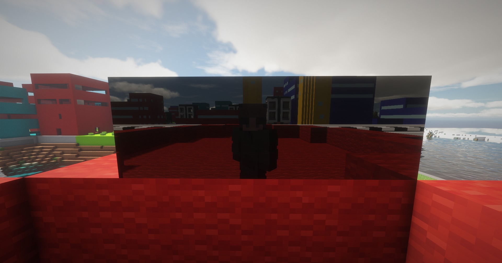
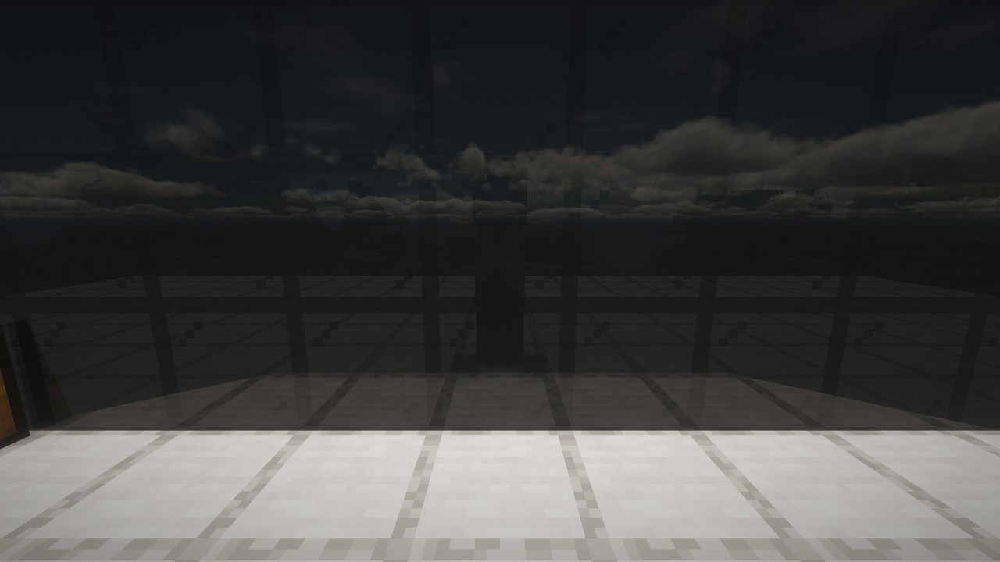
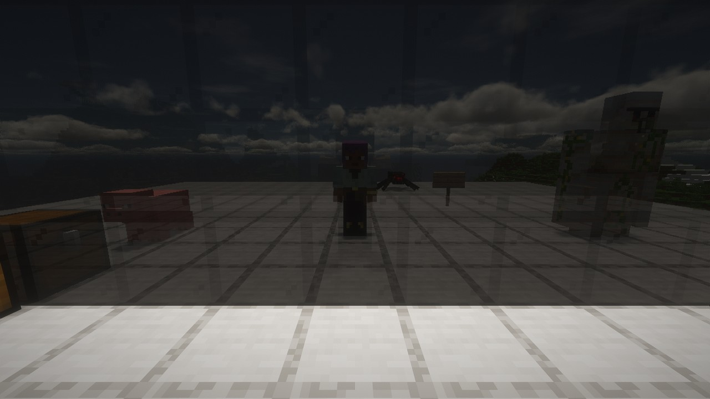

# Shaders Companion

A client-side Forge mod for Minecraft 1.20.1 that gives shader packs a second view. Screen-space reflections can only show what is on screen; with this mod a shader pack can also reflect what is behind or beside the player.

Version 2.0.0. It draws terrain, water, glass, mobs, players, block entities and Distant Horizons' far terrain into a cube around the camera, and mirror views: the world mirrored in the largest water surfaces and glass walls on screen (up to four at once), at screen resolution, with your own player in them. It keeps a copy of the blocks around the camera (the lattice) for steady ambient occlusion and reflections of what no view shows, gives blocks, items and entities without PBR maps a material class, and hands over Minecraft's rain heightmap, so a pack can keep the ground under glass roofs dry. ABZA Shader (bundled, 2.0.0) reads all of them.

**The mirror view is experimental.** In ABZA Shader it is on in the Ultra and Max presets; "Shaders Companion mirror view" (Shaders Companion screen), or `mirror = false` in the config, turns it off and leaves the cube's reflections working.

| Without the mod | With the mod |
|---|---|
|  |  |

## Install

Put the jar in `mods` next to Oculus and Embeddium, start the game and choose "ABZA Shader.zip" under Options, Video Settings, Shader Packs. The mod is client only. Downloads are on CurseForge; the public description and changelog are in [curseforge/](curseforge/).

## How it works

- Every frame, just before the world renders and outside Oculus's world pass, the mod redraws one or more faces of a cube around the camera (two of six by default, so the whole cube every third frame).
- It doesn't rebuild any geometry. It draws the chunk meshes Embeddium has already built and uploaded, straight from Embeddium's region buffers, with its own small GL program: solid and cut-out blocks, then translucent ones (water, glass) over them. It reads Oculus's extended terrain vertex layout, so it gets each block's `block.properties` id too. Sections in range that Embeddium hasn't built yet (behind the player) are queued for building.
- Entities and block entities are drawn through Minecraft's own entity and block-entity renderers into a buffer source that keeps each render type's texture and stores the vertices for the mod's entity program, so modded mobs draw like vanilla ones. Oculus only wraps its own buffer sources, so it leaves this one alone. Nearest first, within a small time budget per frame.
- With Distant Horizons 3.3.2 installed, its LOD meshes are drawn too, straight from the vertex buffers Distant Horizons keeps for each LOD section (read-locked while drawing, as Distant Horizons' own renderer does), beyond the chunk terrain's range.
- The mirror view: a few rays from the camera each frame find the reflecting surfaces on screen (water, and blocks drawn in the translucent layer such as stained and tinted glass). The rays stop at collision shapes, so grass and flowers don't hide the water behind them, and water past the chunk terrain's range (Distant Horizons water) counts while the rays find that water level nearer by. The flat surfaces covering the most screen become the mirror planes (as many as the pack asks for, up to four: a lake and a window beside it), and the same terrain, entities and LODs are drawn once more for each from the camera mirrored in its plane, at the screen's resolution, with everything behind the plane cut away. Your own player is drawn into it too, so you can see yourself in water and glass. A pack reads a plane's view where a pixel lies on that plane: sharp reflections there, and the cube for everything else.
- Shadows for the mirror view: Oculus draws into a pack's shadow map only what can cast a shadow into your own view, so things behind you would have no shadows in reflections, and the shadows would come and go as you turn. While a mirror view is drawn, a small mixin into Oculus's shadow culling also keeps whatever can cast a shadow into the mirror view (`mirrorShadows` in the config).
- What lies behind water and glass: the mirror view is copied after its opaque surfaces and before water and glass are drawn over them (only while a pack reads the copy), so a pack can shade reflected water over the depth below it and let glass tint what is behind it.
- Rain cover: Minecraft's `MOTION_BLOCKING` heightmap (where the game stops rain) for 512 x 512 blocks around the camera, read per chunk as chunks come into range and again in turn for placed and broken blocks, uploaded only where it changed. Glass lets full sky light through, so a pack can't tell from sky light alone that a glass roof keeps the rain off.
- The lattice (from 2.0.0): a copy of the blocks around the camera (a box 128 blocks tall and 64, 128 or 256 wide, `latticeSize`), each block's shape in quarter blocks, its light, glow and material class, kept on the GPU and updated only where blocks or light change, within a time budget per frame. From it the mod bakes an openness field (how closed in each half block is, once per change), which gives a pack ambient occlusion that doesn't change with the view, and a pack can trace reflection rays through it where neither the screen nor the cube can answer them.
- Light leaks through stairs and slabs (from 2.0.0): smooth lighting averages the light of the cells around each face, and a stair or slab stores the light that comes in through its open sides, so a wall of stairs with its flat back to a dark room lights the floor, ceiling and walls along it with the daylight outside (vanilla and Embeddium alike; shader packs show it far more). While a shader pack is in use, a small mixin into Embeddium's smooth lighting (`AoFaceData`) leaves out a cell's light when it is more than could have come through an open side (the light engine's own drop per step) and a block that closes sides by its shape is around, so such a cell counts like a solid block. Everywhere else the light is Embeddium's unchanged: in an open-air test scene with the natural terrain around it (caves, water, lava, dripstone), no light was left out. `lightLeakFix` in the config; the terrain is rebuilt when it or the shader pack changes. Embeddium counts a mod with mixins into it as tainting it unless the mod depends on exactly one Embeddium version, so this mod requires Embeddium 0.3.31 exactly.
- Light through closed doors (from 2.0.0): Minecraft's light engine lets light through doors and trapdoors, open or closed (they aren't full blocks), so a closed room is lit by the sky or a lamp outside its door. While the light leak fix is on and the shader pack's "Closed doors keep light out" option is on (off by default in ABZA Shader: the room's light changes at once when a door opens), the client works out the light near each closed door (vanilla's and modded doors and trapdoors, glass doors left out) as it would be with the door solid, the way the light engine itself takes light out when a block turns solid, and chunk meshes, mobs, block entities and the shader pack's eye brightness use it. Doors within 30 blocks of each other are worked out together, and again only when light or blocks change within their reach. The server's light, and so mob spawning, is untouched.
- Materials (from 2.0.0): blocks, items and entities without a resource pack's own PBR maps get a material class (glass, iron, polished stone ...) from the mod's tables and from their sound, tags and name, for a shader pack that reads `shaderscompanion:material_table`. Players and modpack makers can set any of them in `config/shaderscompanion/*.rules`, one rule per line, in the style of Scalpel's and Lathe's rules: `metal betterblockz:ironslate_*`, `none mdm:white_bathtub`, `glass #forge:glass`, `item metal tacz:modern_kinetic_gun`, `entity paint superbwarfare:*` (`*` never crosses the `:`; later rules win; the folder gets a commented `example.rules` listing the classes). `config/shaderscompanion-materials.json` (class name -> targets, with `items` and `entities` objects) is still read, before the rules files. They take effect when the shader pack is next loaded. TaCZ's first-person guns are drawn with their item's id, which TaCZ's own renderer leaves out, so they take their class like any held item.
- It writes surface data, not a finished picture: colour, normal, block and sky light, what the texel is (block id, entity id or LOD material), the block's own light, and distance. The shader pack lights it with its own lighting, so reflections match the rest of the image.
- The textures are registered in Minecraft's texture manager as `shaderscompanion:cube_*`. A pack binds them with `customTexture` lines in `shaders.properties`; Oculus looks them up by name on every bind. Without the mod, Oculus binds Minecraft's missing texture, which the pack can detect and fall back from. The mod counts those lookups and draws only while the active pack makes them, so other packs cost nothing.
- Every GL state the mod touches is read before drawing and put back afterwards through `GlStateManager`, so vanilla's, Oculus's and Embeddium's state caches stay correct.

The format is in [API.md](API.md), with reference GLSL in [api/shaderscompanion.glsl](api/shaderscompanion.glsl) (0BSD, free to copy into any pack).

## Bundled shader pack

The jar carries ABZA Shader (the version in `bundled/pack.properties` inside it) and installs it as `shaderpacks/ABZA Shader.zip` when the game launches, so a modpack only needs the mod. The name has no version, so the selected pack and its settings (`shaderpacks/ABZA Shader.zip.txt`) carry over to the next version.

- It writes the file only when it is missing, or when it is still the copy the mod wrote last time (its SHA-256 is kept in `config/shaderscompanion/bundled-pack.properties`) and the jar carries another version. A file you put there yourself is left alone (the log says so); delete it to get the mod's copy back. Nothing else in `shaderpacks` is touched, and the mod never changes which pack is selected.
- `installBundledPack = false` in `config/shaderscompanion-client.toml` turns it off.
- It runs as the game launches, from the mixin config plugin: Oculus reads its pack when the renderer starts, which is before mods are constructed and their configs loaded. The config file is read directly there.
- A modpack that wants ABZA Shader on by default ships `config/oculus.properties` with `shaderPack=ABZA Shader.zip` (and its own `shaderpacks/ABZA Shader.zip.txt` for settings), but not the zip itself.

ABZA Shader is GPL-3.0 (a fork of Sundial Lite by GeForceLegend). It ships unchanged as a separate file with its licence inside; its source is at https://github.com/RinkyDinkyNooble/abza-shader-pack. This mod's own code stays 0BSD.

## Requirements

Minecraft 1.20.1, Forge 47, Oculus 1.8.0, Embeddium 0.3.31 (exactly, from 2.0.0); Distant Horizons 3.3.2 optional. Built and tested against exactly those versions (the ABZA modpack's); it reads Embeddium's, Oculus's and Distant Horizons' internals, so other versions may need changes. It does nothing while no shader pack is active, or while the active pack doesn't read the cube.

## In game

- `/shaderscompanion debug` shows the six faces in the top-left corner, lit with a rough preview, and the mirror view next to them while there is one, with the cost per frame.
- `/shaderscompanion status` prints the same in chat.
- `/shaderscompanion dump` saves the faces to `screenshots/shaderscompanion-<time>-preview.png`, `-albedo.png` and `-distance.png`, and the mirror view to `-mirror.png`.
- `/shaderscompanion off` stops all of the mod's drawing at once, without a restart or a shader reload (reflections fall back to the pack's own); `/shaderscompanion on` starts it again. Both set `enabled` in the config.
- Mobs and block entities are a frame late in the views (they are collected after the world is drawn, so mods that animate mobs see the game's own draw first); your own player in the mirror view is not.
- `config/shaderscompanion-client.toml` (read again whenever the file changes): `enabled`, `faceSize` (pixels per face, 512), `facesPerFrame` (2), `maxDistance` (blocks; 0 = render distance), `entities`, `entityDistance` (48), `maxEntities` (48), `entityLod` (far mobs and block entities redrawn every 2nd to 4th frame, moved with them in between), `blockEntities`, `blockEntityDistance` (24), `maxBlockEntities` (32), `distantHorizons`, `lodDistance` (blocks; 0 = Distant Horizons' range), `mirror`, `mirrorScale` (percent of the screen's resolution, 100), `mirrorShadows` (keep the shadows of what the mirror view shows), `mirrorLod` (lower resolution for a mirror that covers little of the screen), `installBundledPack` (see above), `lattice`, `latticeSize` (64, 128 or 256 blocks), `latticeBudget` (microseconds a frame, 1000), `lightLeakFix` (no light through the closed sides of stairs and slabs while a shader pack is in use, nor through closed doors and trapdoors while the pack's option for them is on), `materials` (the material classes).
- The mod draws a view only while the active shader pack reads it. In ABZA Shader, turning off "Shaders Companion reflections" and "Shaders Companion mirror view" (or reflections altogether, as the Low and Medium presets do) stops the cube and the mirror view.

## Building

1. Put the jars it compiles against in `libs/` (gitignored), named `oculus-1.8.0.jar`, `embeddium-0.3.31.jar`, `distanthorizons-3.3.2.jar` and `tacz-1.1.8.jar` (copied from the ABZA instance's `mods` folder; TaCZ without its nested jars).
2. Build ABZA Shader in its repo next to this one (`python tools/build.py <version>`): the build copies `../abza-shader/dist/ABZA Shader v<bundled_pack_version>.zip` into the jar and stops if it is missing (`bundled_pack_version` and `bundled_pack_dir` in `gradle.properties`).
3. `gradlew build` with Java 17. The jar is `build/libs/shaderscompanion-<version>.jar`.

### Dev check

`gradlew runClient -PdevDump=600` starts a dev client with Oculus and Embeddium, makes a fresh world, lifts the player 60 blocks (`-PdevLift=0` keeps them on the ground), waits until the cube has been drawn 600 times, saves it and a screenshot to `run/screenshots/` and quits. Scenes (`-PdevScene=`): `pool`, a water pool under a glowstone ceiling above the camera's view (`-PdevPitch` sets how far it looks down), saved with the mod drawing and turned off; `mobs`, still mobs, a chest and a sign around the camera on a platform; `mirror`, a black glass wall in front with the mobs behind the camera, saved with the mod on and off (the mirror view shows your player in the glass). `corner` and `grass` check the mirror's choice of plane and plants in reflections, `ocean` and `match` far water and the reflections' lighting, `shadows` the shadows of what is behind the camera in the glass, and `move` the glass while walking (see `src/verify`). `-PdevSize=1920x1009` sets the window's size. `-PdevToggle=<option>` (ocean scene) times a shader pack option off and on in alternating rounds. `-PdevDh` loads Distant Horizons too. `-PdevQuit` (without `-PdevDump`) logs the status at the title screen and quits, a quick check of the bundled pack's install. It needs a shader pack in `run/shaderpacks/` named in `run/config/oculus.properties`. The code lives in `src/verify/` and never ships.

## Not yet

Particles in reflections; textured Distant Horizons LODs; a mirror in a mirror.

## License

0BSD (see [LICENSE](LICENSE)). Oculus, Embeddium and Distant Horizons aren't included; this mod only calls them.
