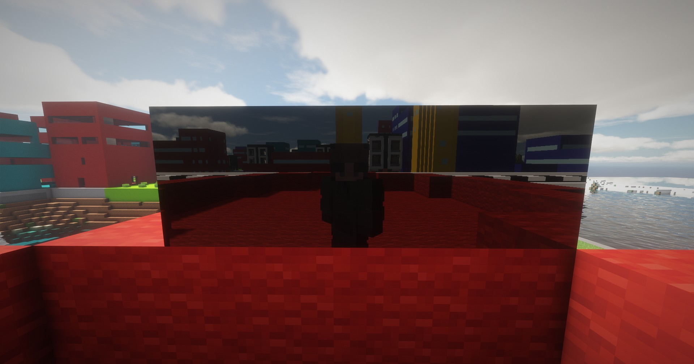
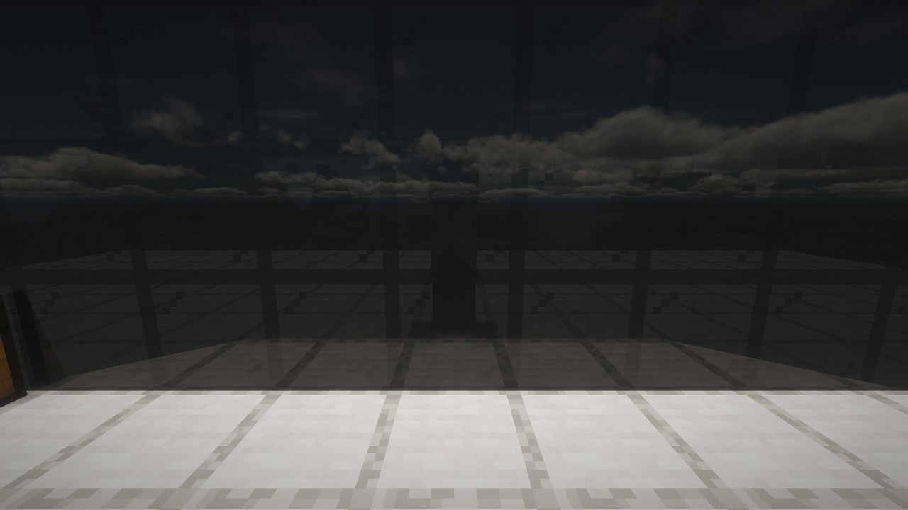
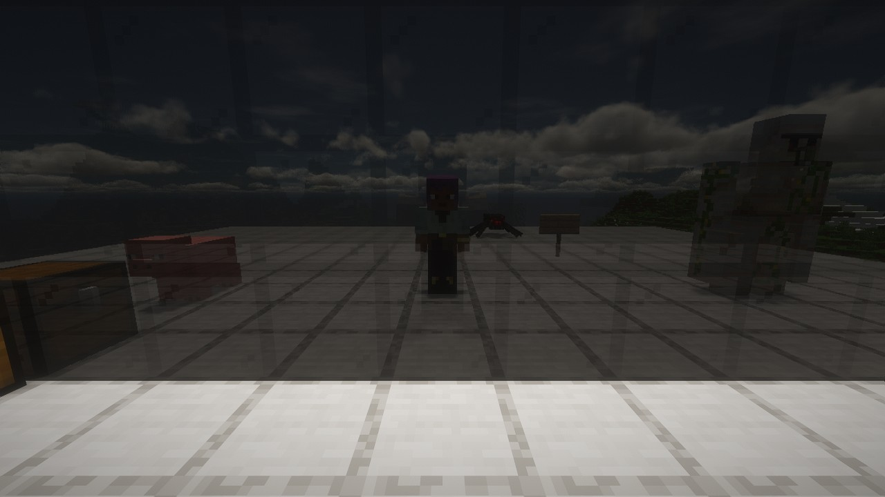
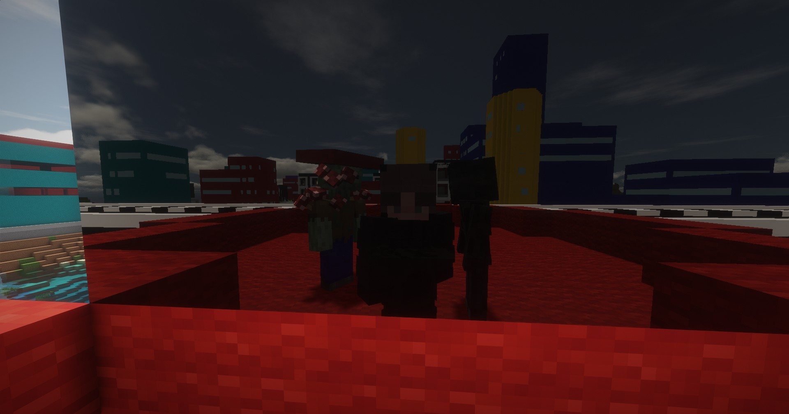

# Shaders Companion

Shader packs can only reflect what is on your screen and draw what is within your render distance. **Shaders Companion** gives them the rest of the world: <strong>far terrain</strong> out to 1,024 blocks, shaded by the shader pack like the land around you, and water and glass that become <strong>real mirrors</strong> showing **yourself**, the mobs and buildings behind you and the land far away. Every other shiny surface reflects the room around it, lamps' glow included. It also gives shader packs **ambient occlusion that stays put**, a **material for every block** and lighting fixes no shader pack can make on its own.

It comes with [ABZA Shader](https://www.curseforge.com/minecraft/shaders/apocalypse-begins-sundial-lite-fork), which uses all of it out of the box: install the mod and pick "ABZA Shader.zip" in the shader pack list. Made for the [ABZA modpack](https://www.curseforge.com/minecraft/modpacks/apocalypse-begins-zombie-apocalypse). <strong>Oculus and Embeddium are required.</strong>

***

## Requirements

<table>
<tr><th align="left">What</th><th align="left">Version</th></tr>
<tr><td><strong>Forge</strong></td><td>47</td></tr>
<tr><td><strong>Side</strong></td><td><strong>Client</strong>; on a server <strong>optional</strong>, for sharing far terrain</td></tr>
<tr><td><strong><a href="https://www.curseforge.com/minecraft/mc-mods/oculus">Oculus</a></strong></td><td>1.8.0</td></tr>
<tr><td><strong><a href="https://www.curseforge.com/minecraft/mc-mods/embeddium">Embeddium</a></strong></td><td>0.3.31, exactly this version</td></tr>
<tr><td><strong><a href="https://www.curseforge.com/minecraft/mc-mods/distant-horizons">Distant Horizons</a></strong></td><td><strong>Optional</strong>, tested with 3.3.2</td></tr>
<tr><td><strong><a href="https://www.curseforge.com/minecraft/shaders/apocalypse-begins-sundial-lite-fork">ABZA Shader</a></strong></td><td>3.0.0, <strong>included</strong></td></tr>
</table>

***

## With And Without

<table>
<tr>
<td align="center"></td>
<td align="center"></td>
</tr>
<tr>
<td align="center"><strong>Without</strong> The glass has nothing to show</td>
<td align="center"><strong>With</strong> You, entities, and other blocks are reflected</td>
</tr>
</table>

<em>The same spot and settings: a wall of black stained glass with everything else behind the camera.</em>

***

## Features

### Far Terrain

The land past your render distance, out to 1,024 blocks, drawn by the mod and lit, fogged and shadowed by the shader pack like the land around you: far mountains cast shadows, clouds pass over them and the sun throws shafts of light past them. It is in reflections and mirrors too. On by default.

*   **Singleplayer:** the far terrain fills from your world's saved chunks as soon as you join, so land you explored long ago or pre-generated with Chunky shows at once.
*   **Servers:** it is what you have seen there, and with the mod on the server too, everything the server has saved around you (see below).
*   **With Distant Horizons:** while Distant Horizons draws the far terrain, the mod stays out of its way on screen and still puts far terrain in reflections.
*   **Disk:** the far terrain is kept in `shaderscompanion/lod`, at most 4 GB for every world and server together; the worlds you visited longest ago make room first.

### Far Terrain From Servers

Put the mod on your server too, and every player who has it sees the land other players have explored, not only their own: the server sends the world's saved chunks around each player in the background, and new and changed chunks as it saves them. Ores and hidden rooms deep inside the rock are never sent, so it can't be used as x-ray. Players without the mod can still join, a player can turn it off for one server, and the server's owner sets how far and how fast in `config/shaderscompanion-common.toml`.

### Real Mirrors

The largest water surfaces and walls of stained or tinted glass on screen, <strong>up to four at once</strong>, show a sharp reflection of the world with the shader pack's own light and shadows: you, your gun and armour, mobs, other players, chests and the far terrain. A lake and a window beside it, or two walls of a glass building, each get their own. In ABZA Shader the mirror is on in the Ultra preset (one) and the Max preset (four).

<table>
<tr>
<td align="center"></td>
<td align="center"></td>
</tr>
<tr>
<td align="center"><strong>Mobs And Players</strong> You and the mobs next to you, up close</td>
<td align="center"><strong>Gun And Armour</strong> What you hold and wear, in black glass</td>
</tr>
</table>

### Reflections Of Everything Else

Every other reflecting surface shows what is behind, beside and above you instead of nothing. Indoors, shiny floors and walls reflect the room around them instead of the sky through the walls, lamps' glow included, shaded like the rest of the screen. Reflected water has its colour, waves and sky, and reflected stained glass tints what lies behind it.

### Ambient Occlusion That Stays Put

The mod keeps a copy of the blocks around you, so the shading in corners, under overhangs and around furniture no longer changes as you turn or flickers as things move past. On in every ABZA Shader preset.

### Auto-PBR Material Engine

Blocks without a resource pack's PBR maps get a material, so glass, ice, polished stone, metals and gems reflect and shine as they should. Vanilla blocks and Mekanism's, Superb Warfare's and Ad Astra's machines come from the mod's tables, other modded blocks from their sound, tags and name. Rules of your own go in `config/shaderscompanion/*.rules` (an example file is written there). In ABZA Shader: the Max preset, or "Auto-PBR Material Engine" on the Shaders Companion screen.

### Held Items That Reflect

With "Held items reflect the world" on, what you hold reflects the world around you, TaCZ guns included. "Entity materials" (experimental) does the same for armour, vehicles and dropped items. Both are off by default.

### Light Stays Where It Belongs

Light no longer leaks through the closed sides of stairs and slabs into dark rooms. With "Closed doors keep light out" on (off by default), closed doors and trapdoors keep the light out too.

### Dry Under Glass Roofs

In rain, the ground under glass roofs stays dry, where the rain itself stops.

### No Cost When Unused

The mod only draws while the active shader pack uses it. `/shaderscompanion off` stops it at once, and `/shaderscompanion on` starts it again.

<strong>NOTE</strong>: clear glass is see-through and doesn't act as a mirror. Stained and tinted glass, ice and water do.

***

## Gallery

<table>
<tr>
<td align="center"></td>
<td align="center"></td>
</tr>
<tr>
<td align="center"><strong>Many Features Combined</strong> You, the town and the sky in one glass wall</td>
<td align="center"><strong>Indoors</strong> A diner with ceiling lights and a glowing sign</td>
</tr>
<tr>
<td align="center"></td>
<td align="center"></td>
</tr>
<tr>
<td align="center"><strong>Wet Streets</strong> Neon lines in the puddles</td>
<td align="center"><strong>Ship At Night</strong> Its lights on the water in the rain</td>
</tr>
</table>

<em>All shots with ABZA Shader, which comes with the mod.</em>

***

## ABZA Shader Included

The mod puts ABZA Shader into your `shaderpacks` folder as "ABZA Shader.zip" when the game starts. This copy has the mod's options on its Shaders Companion screen and an extra Max preset; the standalone download of the pack has them off.

*   **Updates:** a newer version of the mod replaces its own copy of the pack and keeps your shader settings.
*   **Turning it off:** set `installBundledPack = false` in `config/shaderscompanion-client.toml`.

***

## Commands

<table>
<tr><th align="left">Command</th><th align="left">What it does</th></tr>
<tr><td><strong>/shaderscompanion on</strong></td><td>Starts the mod's drawing</td></tr>
<tr><td><strong>/shaderscompanion off</strong></td><td>Stops it, without a restart; reflections go back to the shader pack's own</td></tr>
<tr><td><strong>/shaderscompanion status</strong></td><td>Shows what is being drawn and what it costs</td></tr>
<tr><td><strong>/shaderscompanion debug</strong></td><td>Shows the mod's views in the corner of the screen</td></tr>
<tr><td><strong>/shaderscompanion dump</strong></td><td>Saves the views to the screenshots folder</td></tr>
<tr><td><strong>/shaderscompanion far on</strong> / <strong>far off</strong></td><td>Turns the far terrain on or off</td></tr>
<tr><td><strong>/shaderscompanion far server deny</strong> / <strong>allow</strong></td><td>Turns down (or takes again) the far terrain the server you are on shares</td></tr>
<tr><td><strong>/farshare</strong></td><td>On a server, for operators: what the server shares with whom</td></tr>
</table>

***

## For Shader Pack Authors

Any shader pack can use the mod's views, its far terrain, its copy of the blocks around the camera, its material classes and its map of where rain falls, and a pack that uses them still works without the mod. The format and reference code are in [API.md](https://github.com/RinkyDinkyNooble/shaders-companion/blob/main/API.md) on GitHub.

***

## Known Limits

*   **The mirror view** is <strong>experimental</strong>. To turn it off, switch off "Shaders Companion mirror view" (Shaders Companion screen) or set `mirror = false` in `config/shaderscompanion-client.toml`; the other reflections keep working.
*   **Far terrain** has one colour per block face, not textures, and leaves out grass and flowers.
*   **Distant Horizons' own terrain** isn't drawn into reflections any more; Shaders Companion 2.0.0 still does that.
*   **Particles** aren't reflected, and a mirror doesn't show another mirror's reflection.
*   **Four mirrors at most:** other reflecting surfaces on screen get the less sharp reflection.
*   **Other versions** of Oculus, Embeddium and Distant Horizons than the ones above may not work.

***

## Credit

Shaders Companion comes with **ABZA Shader** as a separate file under its own licence (GPL-3.0). ABZA Shader is a fork of [Sundial Lite](https://www.curseforge.com/minecraft/shaders/sundial-lite) by GeForceLegend; its source is on [GitHub](https://github.com/RinkyDinkyNooble/abza-shader-pack). [Oculus](https://www.curseforge.com/minecraft/mc-mods/oculus) is made by NanoLive, dima_dencep and the Iris team, and [Embeddium](https://www.curseforge.com/minecraft/mc-mods/embeddium) by embeddedt. Neither is affiliated with this mod. The mod's own code is 0BSD and on [GitHub](https://github.com/RinkyDinkyNooble/shaders-companion).
