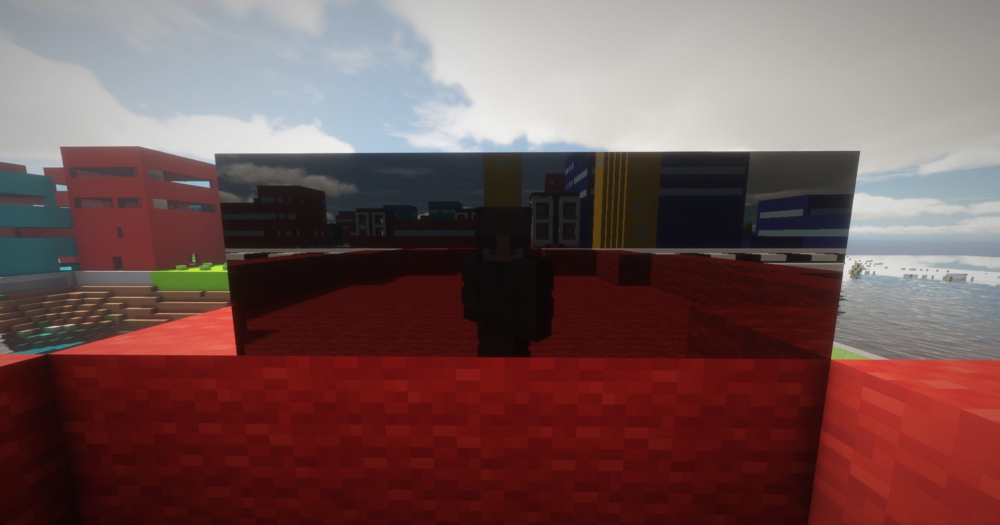
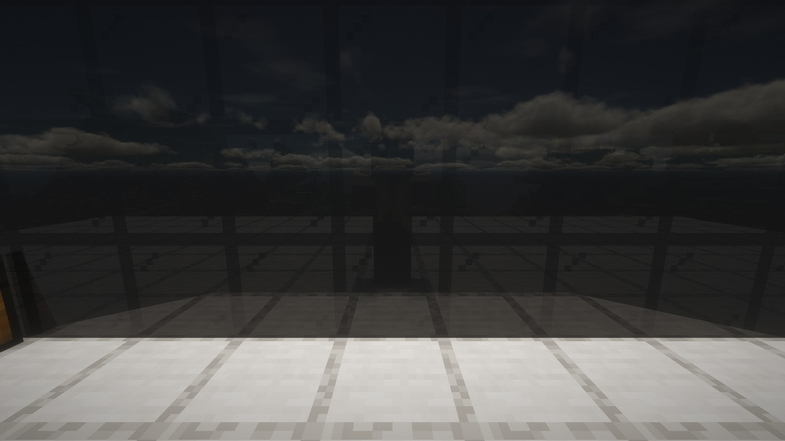
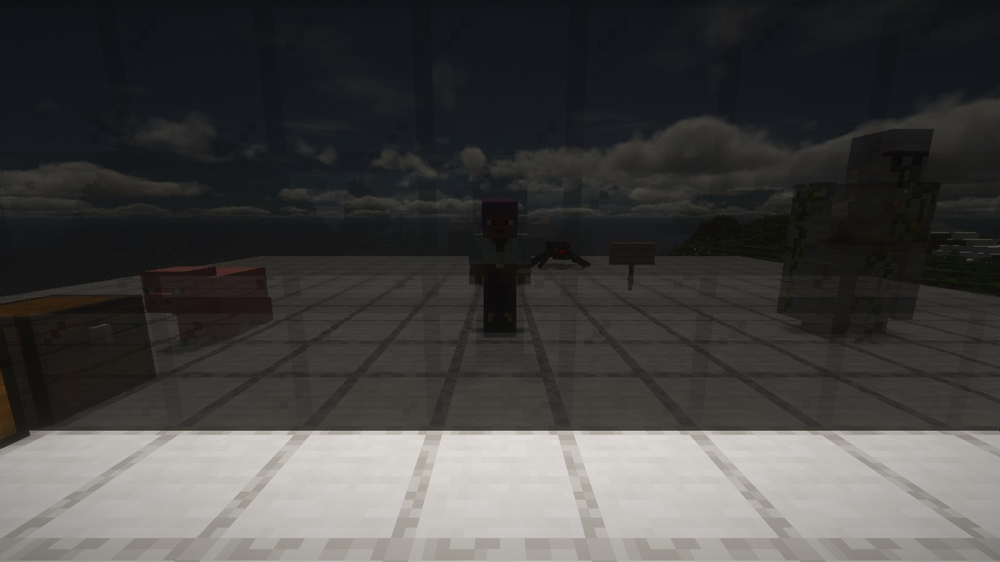
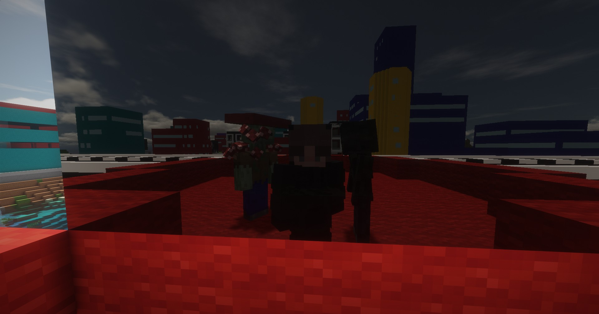

# Shaders Companion

Shader packs can only reflect what is on your screen. **Shaders Companion** gives them the rest of the world: water and stained or tinted glass become <strong>real mirrors</strong> that show **yourself**, the mobs and buildings behind you and the terrain far away.

It comes with [ABZA Shader](https://github.com/RinkyDinkyNooble/abza-shader-pack), which uses it out of the box: install the mod and pick "ABZA Shader.zip" in the shader pack list. <strong>Oculus and Embeddium are required.</strong>

***

## Requirements

<table>
<tr><th align="left">What</th><th align="left">Version</th></tr>
<tr><td><strong>Forge</strong></td><td>47</td></tr>
<tr><td><strong>Side</strong></td><td><strong>Client only</strong></td></tr>
<tr><td><strong><a href="https://www.curseforge.com/minecraft/mc-mods/oculus">Oculus</a></strong></td><td>1.8.0</td></tr>
<tr><td><strong><a href="https://www.curseforge.com/minecraft/mc-mods/embeddium">Embeddium</a></strong></td><td>0.3.31</td></tr>
<tr><td><strong><a href="https://www.curseforge.com/minecraft/mc-mods/distant-horizons">Distant Horizons</a></strong></td><td><strong>Optional</strong>, 3.3.2</td></tr>
<tr><td><strong>Shader pack</strong></td><td>ABZA Shader 1.0.23, <strong>included</strong></td></tr>
</table>

***

## With And Without

<table>
<tr>
<td align="center"></td>
<td align="center"></td>
</tr>
<tr>
<td align="center"><strong>Without</strong> The glass has nothing to show</td>
<td align="center"><strong>With</strong> You, the mobs, the chest and the bed behind you</td>
</tr>
</table>

<em>The same spot and settings: a wall of black stained glass with everything else behind the camera.</em>

***

## Gallery

<table>
<tr>
<td align="center"></td>
<td align="center"></td>
</tr>
<tr>
<td align="center"><strong>Mobs And Players</strong> You and the mobs next to you, up close</td>
<td align="center"><strong>Distant Horizons</strong> The city behind you, far terrain included</td>
</tr>
</table>

***

## What It Does

*   **Mirrors:** the largest water surface or wall of stained or tinted glass on screen shows a sharp reflection of the world, your own player included, with the shader pack's own light and shadows.
*   **Every other reflecting surface** shows what is behind, beside and above you, where it used to show nothing.
*   **What you see in them:** terrain, water, glass, mobs, other players, chests and other block entities, and Distant Horizons' far terrain.
*   **No cost when unused:** the mod only draws while the active shader pack uses it. `/shaderscompanion off` stops it at once, and `/shaderscompanion on` starts it again.

<strong>NOTE</strong>: clear glass is see-through and doesn't act as a mirror. Stained and tinted glass, ice and water do.

***

## ABZA Shader Included

The mod puts ABZA Shader into your `shaderpacks` folder as "ABZA Shader.zip" when the game starts. Choose it under Options, Video Settings, Shader Packs.

*   **Updates:** a newer version of the mod replaces its own copy of the pack and keeps your shader settings.
*   **Your own copy:** a file you put there yourself under that name is left alone.
*   **Turning it off:** set `installBundledPack = false` in `config/shaderscompanion-client.toml`.

***

## Commands

<table>
<tr><th align="left">Command</th><th align="left">What it does</th></tr>
<tr><td><strong>/shaderscompanion on</strong></td><td>Starts the mod's drawing</td></tr>
<tr><td><strong>/shaderscompanion off</strong></td><td>Stops it, without a restart; reflections go back to the shader pack's own</td></tr>
<tr><td><strong>/shaderscompanion status</strong></td><td>Shows what is being drawn and what it costs</td></tr>
<tr><td><strong>/shaderscompanion debug</strong></td><td>Shows the mod's views in the corner of the screen</td></tr>
<tr><td><strong>/shaderscompanion dump</strong></td><td>Saves the views to the screenshots folder</td></tr>
</table>

***

## For Shader Pack Authors

Any shader pack can use the mod's views, and a pack that uses them still works without the mod. The format and reference code are in [API.md](https://github.com/RinkyDinkyNooble/shaders-companion/blob/main/API.md) on GitHub.

***

## Known Limits

*   **TaCZ guns and some modded armour** don't show in reflections yet.
*   **Particles** aren't reflected.
*   **One mirror at a time:** other reflecting surfaces on screen get the less sharp reflection.
*   **After a quick turn,** a mirror can take a moment to fill in.
*   **Other versions** of Oculus, Embeddium and Distant Horizons than the ones above may not work.

***

## Credit

Shaders Companion comes with **ABZA Shader** as a separate file under its own licence (GPL-3.0). ABZA Shader is a fork of [Sundial Lite](https://www.curseforge.com/minecraft/shaders/sundial-lite) by GeForceLegend; its source is on [GitHub](https://github.com/RinkyDinkyNooble/abza-shader-pack). [Oculus](https://www.curseforge.com/minecraft/mc-mods/oculus) is made by NanoLive, dima_dencep and the Iris team, and [Embeddium](https://www.curseforge.com/minecraft/mc-mods/embeddium) by embeddedt. Neither is affiliated with this mod. The mod's own code is 0BSD and on [GitHub](https://github.com/RinkyDinkyNooble/shaders-companion).
